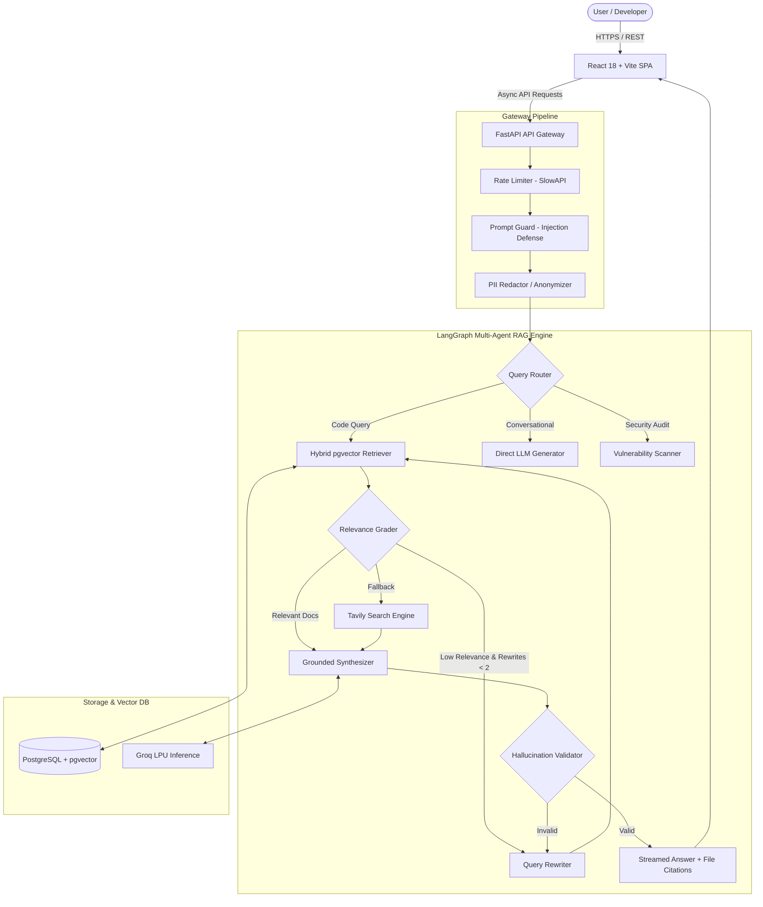

# 🧠 CodeMind AI — Enterprise Agentic Codebase Intelligence & Security Platform

[](https://fastapi.tiangolo.com)
[](https://langchain-ai.github.io/langgraph/)
[](https://www.python.org/)
[](https://react.dev/)
[](https://github.com/pgvector/pgvector)
[](https://aws.amazon.com/)
[](https://www.docker.com/)
[](https://github.com/features/actions)
[](https://opensource.org/licenses/MIT)

> **CodeMind AI** is a production-grade, self-reflective Multi-Agent Code Intelligence & Security Auditing platform. Powered by **LangGraph**, **FastAPI**, **pgvector**, and **React**, CodeMind AI ingests large-scale software repositories, extracts structural AST context, performs hybrid semantic-keyword retrieval, self-corrects hallucinations via automated iterative grading, and conducts deep vulnerability scans across modern codebases.

---

## 📌 Table of Contents

- [Architectural Overview](#-architectural-overview)
- [System Architecture Flow](#-system-architecture-flow)
- [Key Features](#-key-features)
- [Multi-Agent LangGraph Cognitive Engine](#-multi-agent-langgraph-cognitive-engine)
- [Repository Structure](#-repository-structure)
- [Tech Stack](#-tech-stack)
- [Local Development Setup](#-local-development-setup)
  - [Prerequisites](#prerequisites)
  - [1. Clone Repository](#1-clone-repository)
  - [2. Backend Setup](#2-backend-setup)
  - [3. Frontend Setup](#3-frontend-setup)
  - [4. Database Migration](#4-database-migration)
- [API Reference](#-api-reference)
- [Environment Variables Configuration](#-environment-variables-configuration)
- [Deployment (AWS ECR + EC2 + GitHub Actions)](#-deployment-aws-ecr--ec2--github-actions)
- [Security & Guardrails](#-security--guardrails)
- [License & Author](#-license--author)

---

## 🏗 Architectural Overview

CodeMind AI solves the fundamental limitations of naive RAG in software engineering (lost file hierarchy, blind text chunking, hallucinations, and unverified imports) through an **adaptive self-correcting agent graph**:

1. **AST-Aware Code Ingestion**: Parses source code respecting syntactic boundaries (functions, classes, interfaces) with contextual hierarchy tags, avoiding mid-scope text fragmentation.
2. **Hybrid pgvector Retrieval**: Blends high-dimensional vector similarity embeddings (`768-dim`) with PostgreSQL full-text search (`tsvector` BM25) for high-recall identifier matching.
3. **Self-Reflective Grading & Query Rewriting**: An autonomous relevance grader checks retrieved context against the user question. Irrelevant chunks are pruned; if relevance is insufficient, an LLM query rewriter iteratively rephrases the prompt (up to 2 cycles) or falls back to live Tavily web search.
4. **Hallucination Validator & Exact Citations**: Validates synthesized responses against ingested ground truth before streaming, linking every claim directly to exact file paths and line ranges (`app/main.py:L45-L70`).
5. **Static Security Vulnerability Audit**: Scans AST patterns for OWASP Top 10 vulnerabilities, hardcoded secrets, injection vulnerabilities, and provides automated remediation diffs.

---

## 🔄 System Architecture Flow



---

## ⚡ Key Features

- **Multi-Agent RAG with LangGraph**: Deterministic cyclical state graph supporting routing, document grading, iterative query transformation, and validation nodes.
- **Line-Accurate Citations**: Real-time previews of referenced files, start/end lines, and chunk context directly inside the UI.
- **Deep Security Auditing**: Automated static code analyzer detecting hardcoded credentials, SQL injection, SSRF, XSS, and insecure dependencies.
- **Live Thought Stream Debugger**: Transparent real-time visibility into agent reasoning, retrieval scores, latency benchmarks, and tokens consumed.
- **AST-Aware Structural Chunking**: Syntax-guided chunker for Python, JavaScript, TypeScript, Go, Java, Rust, C/C++, HTML/CSS, SQL, and YAML.
- **Enterprise Guardrails**: Integrated Prompt Guard to defeat prompt injection, PII scrubbing (emails, keys, passwords), and rate limiting.
- **Production CI/CD Automation**: GitHub Actions workflow orchestrating Docker builds, automated pushing to **AWS ECR**, and continuous deployment onto **AWS EC2**.

---

## 🤖 Multi-Agent LangGraph Cognitive Engine

| Agent Node | Responsibility | Execution Model |
| :--- | :--- | :--- |
| **`router`** | Classifies query intent (`direct`, `retrieve`, `scan`, `doc`) | Fast LPU Model (`openai/gpt-oss-20b`) |
| **`retriever`** | Hybrid 70% vector cosine similarity + 30% BM25 keyword search | PostgreSQL + `pgvector` |
| **`grader`** | Evaluates document semantic relevance; discards noise | Fast LPU Model |
| **`rewriter`** | Reformulates under-specified queries to maximize vector recall | Fast LPU Model |
| **`web_searcher`** | Discovers external package documentation or recent vulnerability advisories | Tavily API |
| **`generator`** | Synthesizes precise, structured explanations with markdown code | Primary LPU Model (`openai/gpt-oss-120b`) |
| **`validator`** | Cross-examines generated answer against source chunks to block hallucinated symbols | Fast LPU Model |
| **`memory`** | Persists conversation checkpoints and key developer preferences | Checkpointed State Storage |

---

## 📁 Repository Structure

```
CodeMindAI/
├── .github/
│   └── workflows/
│       └── cicd.yaml              # AWS ECR build & EC2 deployment pipeline
├── backend/
│   ├── app/
│   │   ├── agents/                # LangGraph Multi-Agent Architecture
│   │   │   ├── nodes/             # Router, retriever, grader, generator, etc.
│   │   │   ├── graph.py           # Compiled StateGraph workflow definition
│   │   │   └── state.py           # TypedDict GraphState schema
│   │   ├── core/                  # Database connection, config, logging, security
│   │   ├── guardrails/            # Human-in-the-loop and security filters
│   │   ├── middleware/            # Rate limiting, PII redactor, Prompt Guard
│   │   ├── models/                # SQLAlchemy ORM models & Pydantic schemas
│   │   ├── routers/               # FastAPI endpoints (auth, chat, repos, scans, health)
│   │   ├── services/ingestion/    # AST parser, cloner, chunker, embedder, pipeline
│   │   └── main.py                # Application entrypoint & lifespan events
│   ├── requirements.txt           # Python backend dependencies
│   └── .env.example               # Template environment configuration
├── frontend/
│   ├── src/
│   │   ├── components/            # 3D Three.js canvas, ThoughtStream, ChatConsole, etc.
│   │   ├── pages/                 # Landing, Workspace, RepoHealth, Auth, Settings
│   │   ├── services/              # Axios API client & authentication service
│   │   ├── App.tsx                # Client-side router configuration
│   │   └── main.tsx               # React mount root
│   ├── package.json               # Frontend dependencies & scripts
│   └── vite.config.ts             # Vite build & proxy settings
├── Dockerfile                     # Multi-stage production container build
├── .dockerignore                  # Docker build exclusions
├── .gitignore                     # Git tracking exclusions
└── README.md                      # Project documentation
```

---

## 🛠 Tech Stack

- **Backend**: Python 3.11+, FastAPI, LangGraph, LangChain Core, SQLAlchemy 2.0 (asyncpg), Pydantic v2.
- **LLM Inference & Search**: Groq LPUs (`gpt-oss-120b`, `gpt-oss-20b`), HuggingFace Embeddings, Tavily Web Search.
- **Vector Database**: PostgreSQL with `pgvector` extension (Supabase / AWS RDS).
- **Frontend**: React 18, TypeScript, Vite, Tailwind CSS, Three.js, Lucide Icons.
- **Cloud & DevOps**: AWS ECR (Elastic Container Registry), AWS EC2, GitHub Actions, Docker.

---

## 🚀 Local Development Setup

### Prerequisites
- **Python**: 3.11 or newer
- **Node.js**: v18 or newer
- **Git**: Installed and configured
- **PostgreSQL**: With `vector` extension enabled (or a free Supabase database)

---

### 1. Clone Repository

```bash
git clone https://github.com/JatinKumar651/CodeMindAI.git
cd CodeMindAI
```

---

### 2. Backend Setup

```bash
# Navigate to backend
cd backend

# Create virtual environment
python -m venv .venv

# Activate virtual environment
# Windows:
.venv\Scripts\activate
# Linux/macOS:
source .venv/bin/activate

# Install dependencies
pip install --upgrade pip
pip install -r requirements.txt

# Configure environment variables
cp .env.example .env
# Edit .env and supply your GROQ_API_KEY, DATABASE_URL, and SUPABASE credentials

# Run FastAPI backend server
uvicorn app.main:app --reload --host 0.0.0.0 --port 8000
```
Backend API will be live at: `http://localhost:8000` (Interactive Swagger docs: `http://localhost:8000/docs`).

---

### 3. Frontend Setup

In a new terminal:
```bash
# Navigate to frontend
cd frontend

# Install node packages
npm install

# Start Vite development server
npm run dev
```
Frontend Web Application will be live at: `http://localhost:5173`.

---

### 4. Database Setup

Ensure your PostgreSQL instance (Supabase or AWS RDS) has the `vector` extension enabled:
```sql
CREATE EXTENSION IF NOT EXISTS vector;
```
Database models and tables are dynamically managed through SQLAlchemy async models configured in `backend/app/models/orm.py`.

---

## 📡 API Reference

| Method | Endpoint | Description |
| :--- | :--- | :--- |
| `GET` | `/health` | Healthcheck & system status probe |
| `POST` | `/api/repos/ingest` | Ingest and chunk a GitHub repository |
| `GET` | `/api/repos/` | List all indexed repositories |
| `POST` | `/api/chat/message` | Submit a prompt to the LangGraph Multi-Agent RAG pipeline |
| `GET` | `/api/chat/sessions` | Retrieve user chat session history |
| `POST` | `/api/scans/run` | Execute automated static vulnerability security audit |
| `GET` | `/api/scans/{id}` | Retrieve vulnerability audit findings & patch recommendations |

---

## 🔐 Environment Variables Configuration

Copy `backend/.env.example` to `backend/.env` and update the key variables:

```ini
# Application
APP_NAME="CodeMind AI"
PORT=8000
ENVIRONMENT="development"

# PostgreSQL + pgvector
DATABASE_URL="postgresql+asyncpg://postgres:<PASSWORD>@db.<PROJECT>.supabase.co:5432/postgres"

# Groq LLM Inference
GROQ_API_KEY="gsk_..."
GROQ_GENERATION_MODEL="openai/gpt-oss-120b"
GROQ_FAST_MODEL="openai/gpt-oss-20b"

# HuggingFace Embeddings
EMBEDDING_API_URL="https://api-inference.huggingface.co/models/NightOwl-CodeEmbedding"
EMBEDDING_API_KEY="hf_..."

# External Search
TAVILY_API_KEY="tvly-..."
```

---

## ☁ Deployment (AWS ECR + EC2 + GitHub Actions)

The repository includes a production-ready CI/CD workflow at [`.github/workflows/cicd.yaml`](.github/workflows/cicd.yaml):

1. **Continuous Integration (GitHub Hosted Runner)**:
   - Checks out code.
   - Configures AWS credentials using IAM role/user.
   - Authenticates with Amazon ECR.
   - Builds multi-stage Docker container.
   - Pushes versioned and `latest` image to Amazon ECR.

2. **Continuous Deployment (Self-Hosted EC2 Runner)**:
   - Authenticates EC2 instance with Amazon ECR.
   - Pulls updated container image.
   - Gracefully stops older container.
   - Runs updated container exposing port `8000`.
   - Executes container health probe.

### Required GitHub Secrets
Configure these in **GitHub Repository → Settings → Secrets and variables → Actions**:
- `AWS_ACCESS_KEY_ID` & `AWS_SECRET_ACCESS_KEY`
- `AWS_REGION`
- `ECR_REPOSITORY_NAME`
- `DATABASE_URL`
- `GROQ_API_KEY`
- `SUPABASE_URL`, `SUPABASE_ANON_KEY`, `SUPABASE_SERVICE_ROLE_KEY`
- `TAVILY_API_KEY` & `HF_TOKEN`

---

## 🛡 Security & Guardrails

- **Zero Secret Ingestion**: Code ingestion ignores `.env`, lockfiles, keyrings, credentials, and PEM certificates automatically.
- **SSRF Protection**: Remote GitHub URLs are strictly validated and sanitized before cloning.
- **Prompt Injection Defense**: Every chat prompt passes through regex and semantic heuristics to prevent system instruction overrides.
- **PII Scrubbing**: Strips developer emails, IP addresses, and authentication tokens from logged traces.
- **Sandboxed Execution**: Temporary cloned repositories are placed in isolated directories and cleared immediately upon ingestion completion.

---

## 📄 License & Author

Developed by **Jatin Kumar**.
Licensed under the [MIT License](LICENSE).
